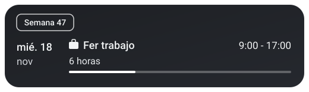

# Simple-Calendars (Month, Week, Day & Event)

Suite de **4 tarjetas personalizadas de Lovelace para Home Assistant** con diseño **minimalista**, control avanzado de **transparencias**, soporte **multi-entidad** nativo (`calendar.*`), traducciones en **7 idiomas** y editor visual completo.



Compatible con **Home Assistant Marketplace** (anteriormente **HACS**) y con vistas **Sections** y **Masonry**.

## Tarjetas incluidas

| Tarjeta | Tipo YAML | Descripción |
| :--- | :--- | :--- |
| **Event Card** | `custom:simple-calendar-event-card` | Tarjeta compacta orientada al momento actual: muestra **Eventos previos**, **Eventos actuales** (con barra de progreso) y **Eventos próximos**, con barra de título y múltiples calendarios. |
| **Calendario Diario** | `custom:simple-calendar-day-card` | Widget minimalista con píldora de semana (`Semana 47`), resumen del día, tiempo restante y barra de progreso en tiempo real. |
| **Calendario Semanal** | `custom:simple-calendar-week-card` | Resumen minimalista semanal por días con píldora de semana, horarios y barras de progreso. |
| **Calendario Mensual** | `custom:simple-calendar-month-card` | Grilla mensual limpia con píldoras por color y resumen minimalista inferior del día seleccionado. |

> *(Nota: para máxima retrocompatibilidad también se aceptan los alias `custom:ha-calendar-month-card`, `custom:ha-calendar-week-card`, `custom:ha-calendar-day-card` y `custom:ha-calendar-event-card`).*

## Características principales

- **Seguimiento en tiempo real (`Event Card`)**: visualiza de un vistazo qué acaba de terminar, qué está ocurriendo ahora mismo con barra de progreso y qué viene después.
- **Opciones avanzadas de visualización**: mostrar/ocultar el día actual (`show_current_day`), mostrar/ocultar eventos de todo el día (`show_all_day_events`) y ubicarlos arriba o abajo (`all_day_position`), mostrar/ocultar eventos ya terminados (`show_completed_events`) y mensaje `"Sin eventos hoy"` cuando no hay actividad.
- **Multi-entidad sin límites**: combina cualquier cantidad de entidades `calendar.*` en una misma tarjeta.
- **Transparencias y efecto cristal (*frosted glass*)**: configura `transparent: true`, `background_opacity` (`0–100%`), `backdrop_blur`, `background_color`, `border_radius`, `hide_border` y `hide_shadow`.
- **Editor visual completo**: configura todas las opciones, colores, íconos y entidades directamente desde la interfaz de Lovelace sin escribir YAML.
- **7 idiomas integrados**: Español (`es`), Chino Simplificado (`zh-Hans`), Alemán (`de`), Inglés (`en`), Portugués (`pt`), Italiano (`it`) y Francés (`fr`), con detección automática desde Home Assistant.

---

## Instalación

### Mediante Marketplace / HACS (Recomendado)

1. Abre **Marketplace** (antes **HACS**) en Home Assistant.
2. Ve a **Frontend** → menú superior derecho **⋮** → **Repositorios personalizados** (*Custom repositories*).
3. Agrega `https://github.com/Lean724/simple-calendars` con categoría **Lovelace** / **Dashboard**.
4. Busca **Simple-Calendars (Month, Week, Day & Event)** e instálalo.
5. Recarga el navegador cuando Home Assistant lo solicite.

### Instalación manual

1. Descarga `simple-calendars.js` desde los *Releases* o desde `dist/simple-calendars.js`.
2. Cópialo en `/config/www/simple-calendars.js`.
3. En Home Assistant ve a **Ajustes → Dashboards → ⋮ → Recursos** y añade:
   - URL: `/local/simple-calendars.js`
   - Tipo: **Módulo JavaScript**

---

## Configuración

### Configuración compartida de entidades (`entities`)

| Opción | Tipo | Por defecto | Descripción |
| :--- | :--- | :--- | :--- |
| `entity` | `string` | **Requerido** | ID de la entidad de calendario (`calendar.*`). |
| `name` | `string` | `friendly_name` | Nombre mostrado en filtros y modales. |
| `color` | `string` | Automático | Color hexadecimal o CSS (ej. `#1a73e8`). |
| `icon` | `string` | `mdi:calendar` | Ícono MDI para el calendario y sus eventos. |
| `hidden` | `boolean` | `false` | Inicia oculto en el filtro rápido. |

### Opciones comunes, Visibilidad y Transparencia

| Opción | Tipo | Por defecto | Descripción |
| :--- | :--- | :--- | :--- |
| `title` | `string` | — | Título mostrado en la barra superior de Event Card y Month Card. |
| `entities` | `list` | **Requerido** | Lista de entidades de calendario (`calendar.*`). |
| `first_day_of_week` | `number` | `1` | `1` para Lunes, `0` para Domingo. |
| `language` | `string` | Automático | `'es'`, `'zh-Hans'`, `'de'`, `'en'`, `'pt'`, `'it'`, `'fr'`. |
| `show_current_day` | `boolean` | `true` | Muestra u oculta la columna/resaltado del día actual. |
| `show_all_day_events` | `boolean` | `true` | Muestra u oculta los eventos de todo el día. |
| `all_day_position` | `'top' \| 'bottom'` | `'top'` | Posición de los eventos de todo el día (arriba o abajo). |
| `show_completed_events` | `boolean` | `true` | Muestra u oculta los eventos ya finalizados. |
| `transparent` | `boolean` | `false` | Fondo 100% transparente sin bordes ni sombras. |
| `background_opacity` | `number` | `100` | Opacidad del fondo de la tarjeta (`0` a `100`). |
| `background_color` | `string` | Tema HA | Color base personalizado para el fondo. |
| `backdrop_blur` | `number` | `0` | Desenfoque de fondo en `px` (`12` automático si `background_opacity < 100`). |
| `border_radius` | `number` | `24` | Radio de las esquinas de la tarjeta en `px`. |
| `hide_border` | `boolean` | `false` | Oculta el borde exterior de la tarjeta. |
| `hide_shadow` | `boolean` | `false` | Oculta la sombra de la tarjeta. |
| `use_entity_color` | `boolean` | `false` | Colorea ícono y barra de progreso con el color del calendario. |

### Opciones de `Event Card` (`custom:simple-calendar-event-card`)

| Opción | Tipo | Por defecto | Descripción |
| :--- | :--- | :--- | :--- |
| `max_previous_events` | `number` | `2` | Cantidad máxima de eventos previos a mostrar (`0` oculta la sección). |
| `max_upcoming_events` | `number` | `2` | Cantidad máxima de eventos próximos a mostrar (`0` oculta la sección). |
| `show_progress_bar` | `boolean` | `true` | Muestra la barra de progreso en los eventos actuales. |
| `show_entity_toggles` | `boolean` | `false` | Muestra filtros rápidos por calendario en la barra de título. |

```yaml
type: custom:simple-calendar-event-card
title: Agenda del momento
max_previous_events: 3
max_upcoming_events: 2
show_all_day_events: true
all_day_position: top
show_completed_events: true
background_opacity: 85
backdrop_blur: 12
entities:
  - entity: calendar.trabajo
    name: Trabajo
    icon: mdi:briefcase
  - entity: calendar.personal
    name: Personal
    icon: mdi:account
```

### Opciones de la tarjeta Diaria (`custom:simple-calendar-day-card`)

| Opción | Tipo | Por defecto | Descripción |
| :--- | :--- | :--- | :--- |
| `show_week_number` | `boolean` | `true` | Muestra la píldora `Semana XX` arriba a la izquierda. |
| `show_progress_bar` | `boolean` | `true` | Muestra la barra de progreso y tiempo restante/duración. |
| `show_navigation` | `boolean` | `false` | Muestra flechas compactas `< Hoy >`. |

```yaml
type: custom:simple-calendar-day-card
show_week_number: true
show_progress_bar: true
show_current_day: true
show_all_day_events: true
all_day_position: top
show_completed_events: true
entities:
  - entity: calendar.fer_trabajo
    name: Fer trabajo
    icon: mdi:briefcase
  - entity: calendar.casa
    name: Casa
    icon: mdi:home
```

### Opciones de la tarjeta Semanal (`custom:simple-calendar-week-card`)

| Opción | Tipo | Por defecto | Descripción |
| :--- | :--- | :--- | :--- |
| `days_to_show` | `number` | `7` | Cantidad de días a mostrar (`1`–`14`). |
| `show_week_number` | `boolean` | `true` | Muestra la píldora de semana. |
| `show_progress_bar` | `boolean` | `true` | Muestra la barra de progreso por evento. |
| `show_empty_days` | `boolean` | `false` | Incluye días sin eventos en el resumen semanal. |
| `show_navigation` | `boolean` | `false` | Muestra flechas compactas `< Hoy >`. |

### Opciones de la tarjeta Mensual (`custom:simple-calendar-month-card`)

| Opción | Tipo | Por defecto | Descripción |
| :--- | :--- | :--- | :--- |
| `max_events_per_day` | `number` | `3` | Cantidad máxima de eventos visibles por celda antes de mostrar `+N más`. |
| `show_week_numbers` | `boolean` | `false` | Muestra la columna izquierda con el número de semana ISO. |
| `compact` | `boolean` | `true` | Celda compacta de altura ajustada. |
| `show_header` | `boolean` | `true` | Muestra la barra de navegación del mes. |
| `show_entity_toggles` | `boolean` | `false` | Muestra chips interactivos para filtrar calendarios. |

---

## Desarrollo

```bash
npm install
npm run build
```

El bundle compilado listo para distribución se genera en `dist/simple-calendars.js` y `simple-calendars.js`.
